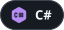

# Hi there, I'm Marcin!

&nbsp;
&nbsp;

 

<b>Lead Unity & Unreal Engine Developer</b> with nearly 7 years of commercial experience delivering interactive 3D, VR and real-time applications. Experienced in software architecture, technical leadership, product development and mentoring development teams. Led the architectural redesign and migration of a mature Unity application into a new Unreal Engine solution. Passionate about designing scalable systems, solving complex technical challenges and continuously improving development workflows.

Throughout my career, I've progressed from Junior Developer to Technical Lead, taking on increasing responsibility for software architecture, product development and technical leadership. I enjoy solving complex engineering challenges, designing scalable systems and turning ideas into reliable, maintainable software.

My experience includes developing large commercial applications, modernizing existing solutions, introducing new technologies and building internal tools that improve development workflows. I also mentor developers, collaborate closely with multidisciplinary teams and help drive technical decision-making throughout the development process.

I hold a Bachelor's degree in Computer Science and was awarded the Rector's Scholarship for outstanding academic performance.

Outside of work, I'm passionate about fantasy, LARP, sewing and video games. I've been programming since 2014, when my curiosity about game development led me to create my first projects.

## Tech stack

**Languages**

  
  
  

**Engines & platforms**

  
  
  
  
  

**Tools & technologies**

  
  
  
  
  
  
  

