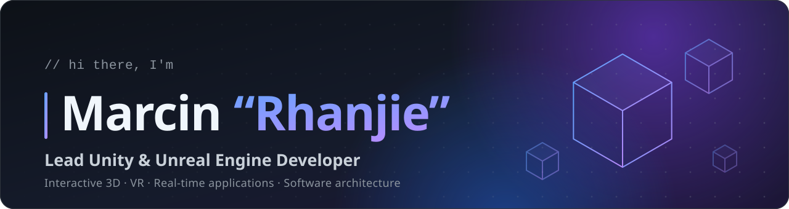

  

&nbsp;
&nbsp;

 

## About me

I'm a **Lead Unity & Unreal Engine Developer** with nearly 7 years of commercial experience delivering interactive 3D, VR and real-time applications. Over that time I've grown from Junior Developer to Technical Lead, taking on increasing responsibility for software architecture, product development and the people who build it.

I enjoy solving complex engineering challenges, designing scalable systems and turning ideas into reliable, maintainable software.

## What I do

- **Software architecture** - designing scalable systems for large commercial applications
- **Engine migration** - led the architectural redesign and migration of a mature Unity application into a new Unreal Engine solution
- **VR & real-time 3D** - building interactive experiences from prototype to production
- **Internal tooling** - creating tools that improve and speed up development workflows
- **Technical leadership** - mentoring developers, working with multidisciplinary teams and driving technical decisions

## Tech stack

**Languages**

  
  
  
  

**Engines & platforms**

  
  
  

**Tools**

  
  
  
  

## Background

- Bachelor's degree in Computer Science, awarded the **Rector's Scholarship** for outstanding academic performance
- Programming since 2014, when curiosity about game development led me to create my first projects
- Outside of work: fantasy, LARP, sewing and video games
